# Skyliner

**User manual, and how the program works**

*See a patch of sky change over time.*

Skyliner shows real infrared images from NASA's SPHEREx space telescope. You pick a place in the sky. It plays the images of that small patch in the order they were taken, like a short video, so that **you** can look for something that moves.

**It shows images only.** It does not detect, measure or name moving objects, and nothing it shows is a discovery. It is a viewer for a person's eyes.

**What is inside**

- **Part 1, User manual.** Start in one minute, then every screen and button, in plain steps.
- **Part 2, How it works.** From NASA's archive to your screen, in plain words.
- **Part 3, Glossary.** The few space words used here.

NASA Space Apps Challenge 2026, challenge 12: Planet X and SPHEREx. Written 15 November 2026.

All screenshots were taken from the running app by an AI assistant, so each one carries a visible "SI-generated" strip below it, as the Space Apps rules ask. The orange numbers on the viewer overview figure were added for this manual.

# Part 1. User manual

## 1.1 Start in one minute

You do not need to install anything to look at NASA's five test targets.

### The fastest way (no installation)

1. Open the project folder on your computer.
2. Open the folder `implementation`, then the folder `web`, and double-click **`index.html`**. It opens in your web browser.
3. Click a test target, for example **Barnard's Star**. The viewer opens with real images.
4. Press the **Space bar** to play. Press it again to pause.

That is all. Nothing is sent anywhere, and nothing is installed.

### To look at any other place in the sky

A place that nobody has looked at before has to be fetched from NASA's public archive first. A small helper program (the "service") does that, and a progress bar shows how far it is.

1. **Once:** install [`uv`](https://docs.astral.sh/uv/), a free tool that starts the helper. It also installs the two small parts the helper needs. You do not install Python by hand.
2. In the project folder, run **`./start.sh`** (Linux or macOS), or double-click **`start.bat`** (Windows).
3. Your browser opens on the app. Type the position, press **Show this position**, and wait a few minutes. To stop the helper, press **Ctrl+C** in the terminal.

You need a computer (Linux, macOS or Windows), a web browser, and an internet connection **only** for new positions.

### The keys you need

| Key | What it does |
|---|---|
| **Space** | Play or pause |
| **Left, Right** | One frame back or forward |
| **Page Up, Page Down** | Page Up: start of this observing window (press again for the previous one). Page Down: the next window |
| **Z** | Magnifier: click the picture to zoom in |
| **Esc** | Zoom back out |

The full list is in section 1.6.

## 1.2 The front page: choose a position

The front page is blank on purpose. It has two boxes and a button.

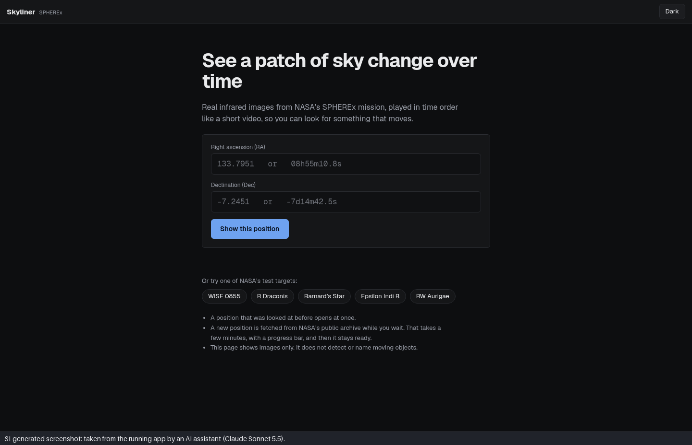

*Figure 1. The front page. Two boxes, one button, and NASA's five test targets under it.*

**Option A, the fast way: click a test target.** The five buttons are NASA's own test targets. They are already prepared, so the viewer opens at once.

**Option B, type a position.**

| Box | You can type | Example |
|---|---|---|
| RA (right ascension) | degrees, or hours-minutes-seconds | `133.795` or `08h55m10.8s` |
| Dec (declination) | degrees, or degrees-minutes-seconds | `-7.2451` or `-7d14m42.5s` |

- RA must be 0 to 360 degrees. Dec must be -90 to +90 degrees. The boxes only accept characters that make sense in a coordinate (digits, signs, a decimal point, the letters `h`, `m`, `s`, `d`, and the marks `:`, `°`, `'` and `"`). A wrong value shows a clear message under the form.

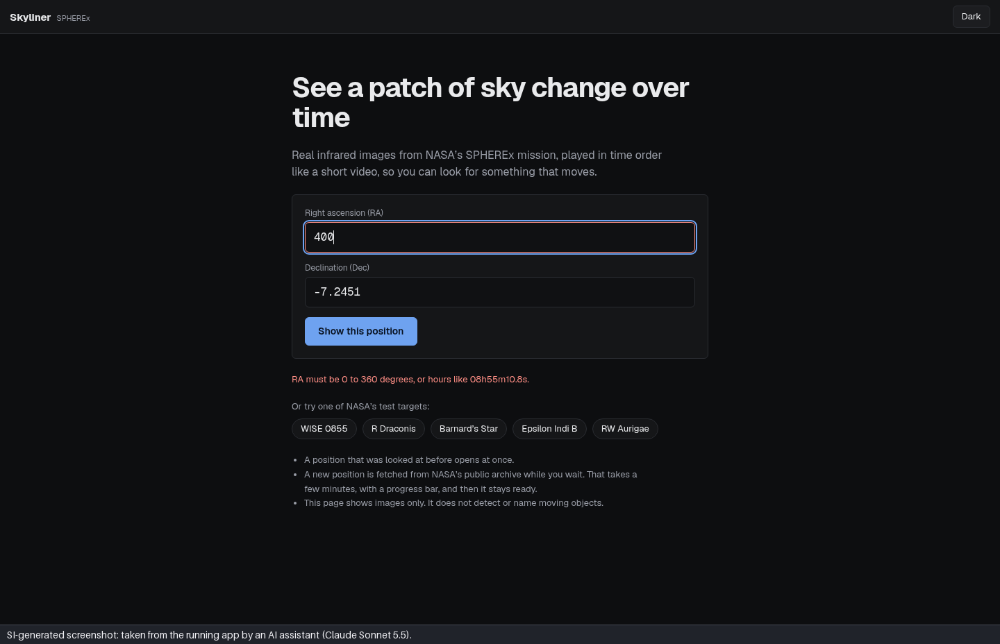

*Figure 2. A wrong value: RA 400 is outside 0 to 360 degrees, so the page says so and does nothing else.*

- Press **Show this position** (or Enter).

**What happens next:**

| Situation | What you see |
|---|---|
| The position was prepared before | "Opening..." and the viewer opens at once. |
| The position is new | A loading screen with the steps and a **progress bar**. The service searches NASA's archive and reads the images of that patch. This takes about **5 to 10 minutes** from Thailand (probably 1 to 2 minutes from the United States). Then the viewer opens, and the position stays ready for next time. You can press **Cancel**. |
| Another position is being prepared | "Waiting: another position is being prepared". Only one position is prepared at a time, because the archive is shared. At most 5 can wait. If the queue is full you see "The queue is full. Try again in a few minutes." |
| NASA has no images there | "NASA's SPHEREx release DR1 has no images of this position. Try another position." SPHEREx data release DR1 does not cover every spot yet. |
| The service is not running | A loading screen that shows the start command and waits. It continues by itself when the service starts. |

If the service is not running when you ask for a new position, the page does not fail: it shows the start command and waits. As soon as you start the service, it carries on by itself.

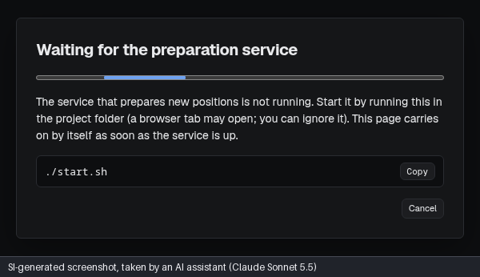

*Figure 3. The page cannot find the service. It shows the start command (with a Copy button) and waits. When the service starts, it carries on by itself.*

The loading screen for a new position looks like this. It says which step it is on, how many images are done and about how long is left. This one is a real job for a position that was not prepared (61 images).

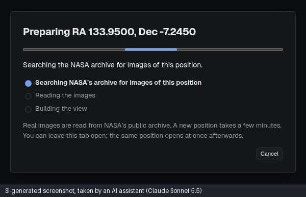

*Figure 4. Preparing a new position: step 2 of 3, image 2 of 61, about 6 minutes left. Cancel stops it and removes the half-made data.*

A new position is prepared on **detector D6** only (the fastest). You can add the other detectors later from the viewer (see 1.4).

## 1.3 The viewer: what is on the screen

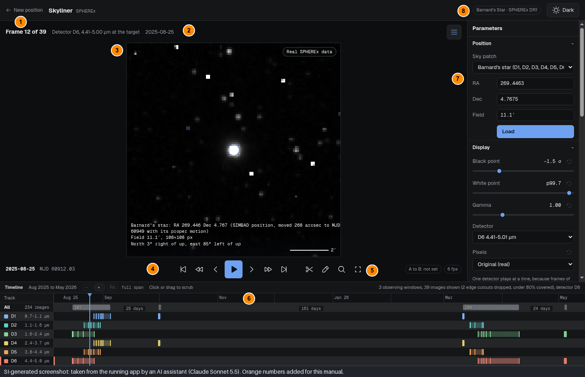

*Figure 5. The viewer on Barnard's Star, detector D6. Orange numbers are explained below.*

The numbers in the figure:

1. **New position:** back to the front page.
2. **Frame heading:** which frame you see (here frame 12 of 39), the detector and its wavelength range at the target, and the date.
3. **The picture:** one real SPHEREx image of the patch, with readouts at the bottom (target, field size, which way is north and east, scale bar).
4. **Transport buttons:** go to start, previous window, back one frame, **play/pause**, forward one frame, next window, go to end.
5. **Tools:** clip A to B (scissors), markers (pen), magnifier, full screen. The speed and "A to B" chips are next to them.
6. **Timeline:** one tick per real image. More in 1.5.
7. **Sidebar (Parameters):** all the settings. The three-line icon at the top right of the picture area opens and closes it.
8. **Target chip:** which position and which data release.

**About the picture.** Every frame is placed on the same sky grid, so a star that does not move stays in the same place from frame to frame. Dark pixels are normal sky. **Blue-grey** pixels mean "this frame has no data here" (the edge of the telescope's detector). They are never filled in. The thin blue circle is the **Requested position** ring (it marks the sky position you asked for; it is not a detection).

**Opening from the front page.** When the viewer opens from the front page, it puts the ring on your position and zooms in to about 4 arcminutes (the small navigator at the top left shows where you are in the whole patch). Press **Esc** to step back out.

**First visit.** A short introduction appears once, with a **Got it** button. You can show it again under **Credits** in the sidebar.

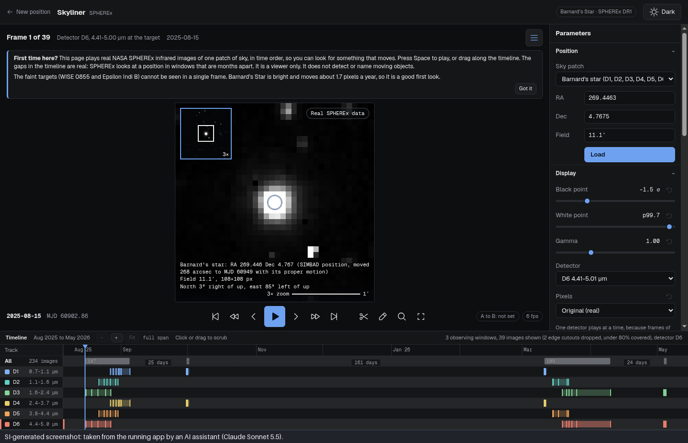

*Figure 6. The first visit: the introduction box on top of the viewer, opened on Barnard's Star from the front page (zoomed on the ring).*

## 1.4 Everyday tasks

### Play and step
- **Play or pause:** press **Space**, or the play button.
- **One frame back or forward:** Left or Right arrow (hold Shift to move 10 frames).
- **Jump between observing windows:** Page Down goes to the next window. Page Up goes to the start of this window, and pressed again to the previous one. The buttons next to the arrows do the same.
- **First or last frame:** Home and End.
- **Speed:** the **Speed** slider under Playback (frames per second). **Frames:** "All frames" or "One per window".
- Navigation always pauses playback first, so the frame you jump to stays on screen.

### Zoom into the picture (magnifier)
- Press **Z** or click the magnifier, then click the picture to zoom in (Shift+click zooms out). The mouse wheel also zooms, drag pans, double-click resets.
- When you are zoomed in, a small **navigator** appears at the top left of the picture. Click or drag it to move the view.
- **Esc** goes back one zoom step. With nothing left to undo it leaves the tool.

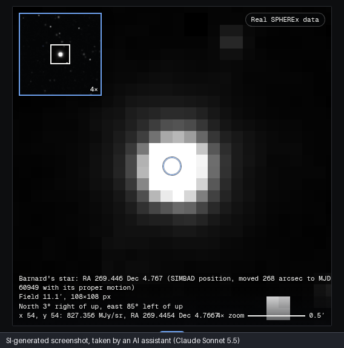

*Figure 7. The picture zoomed in 4 times. The navigator (top left) shows which part of the patch you are looking at; the readout line shows the pixel under the mouse.*


### Change how the picture looks (sidebar, Display)
| Control | What it does |
|---|---|
| Black point, White point, Gamma | Brightness range and curve. Each has a reset button, and double-clicking a slider resets it. |
| Stretch | Linear, Asinh or Log: how brightness is mapped to grey. |
| Smoothing | "None (true pixels)" shows the real 6.15-arcsecond pixels; "Bilinear" smooths them. |
| Pixels | "Original (real)" or "From the lossy cache (decoded in the browser)" (see 2.3). The cache version is for quick looks, not for measuring. |


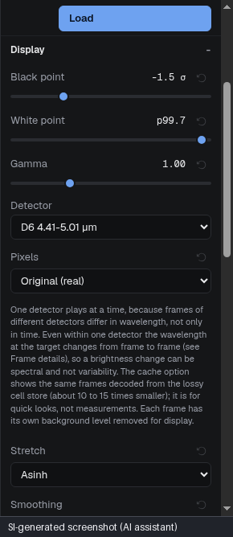

*Figure 8. The sidebar, Display section: black and white point, gamma, detector and pixels.*

Each frame has its own background level removed for display, and the brightness range is shared by all frames of the detector, so the picture does not flicker when the background changes.


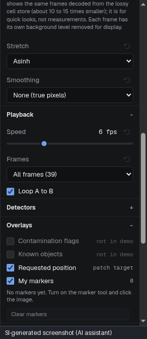

*Figure 9. Further down the sidebar: Stretch and Smoothing, then Playback (speed, frames, loop).*

### Choose a detector
SPHEREx has **six detectors, D1 to D6**, each covering a different range of infrared wavelengths (D1 0.75 to 1.12 µm up to D6 4.41 to 5.01 µm). One detector plays at a time, because frames from different detectors differ in **wavelength**, not only in time.

- Use the **Detector** menu in the sidebar (Display), or click a detector's **lane** in the timeline.
- A detector marked **"not prepared yet"** is read from NASA's archive by the service when you choose it (a few minutes, with a progress bar). Without the service those detectors are greyed out.

### Go to another position or target
- **"New position"** (top left) goes to the front page.
- **Sidebar, Position, "Sky patch"** menu: switch between positions that are already prepared.
- **Sidebar, Position, RA / Dec / Load:** type a position.
  - If it lies **inside the loaded patch** (the patch is about 11 arcminutes across), a **Requested position ring** appears on that spot and the view zooms to about 4 arcminutes. Press Esc to step back. The ring has its own checkbox under **Overlays**. It marks a sky position. It is not a detection.
  - If it lies within 5 arcminutes of the centre of another prepared patch, that patch opens with the ring on it.
  - The **Field** box (11.1′) is accepted but changes nothing yet. A wrong value in it (outside 0 to 240) stops **Load** with a message.
  - Otherwise the viewer asks the service to prepare it (or shows the start command if the service is not running).

This is what a requested position inside the patch looks like:

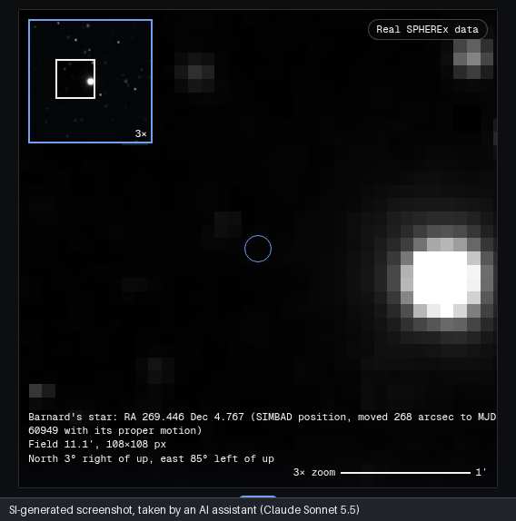

*Figure 10. A requested position inside the patch: the ring marks the spot (the bright star at the right is Barnard's Star itself, about 1.4 arcminutes away).*

### Mark and compare things
- **Markers (pen, key P):** click the picture to drop a marker, click a marker to remove it. Markers are listed in the sidebar. "Clear markers" removes them all. Markers are not saved: reloading the page clears them.
- **Clip A to B (scissors, keys I, O, X):** the first click sets A, the second sets B, the third clears. **Loop A to B** (Playback) is on by default: once A and B are set, playback stays between them (untick it to play all frames). This is a good way to loop one observing window.
- **Full screen (key F):** shows the picture across the whole screen. Space, arrows and the wheel still work. Esc exits.
- **Hover the picture:** shows the pixel position and its value (unit MJy/sr, the unit in NASA's file).

### Dark or light
The **Dark/Light** button (top right, also on the front page) switches theme. Your choice and your display settings are remembered in this browser.

## 1.5 The timeline

The timeline is built from the real exposure times, so it tells the truth about when SPHEREx looked.

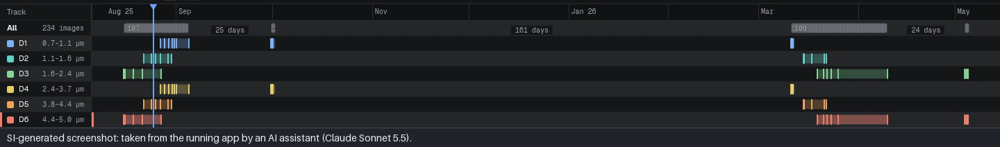

*Figure 11. The timeline over the whole span (Barnard's Star): three observing windows (17, 18 and 4 images), with gaps of 204 and 24 days between them. D1 to D5 say "not prepared"; D6 has real ticks.*

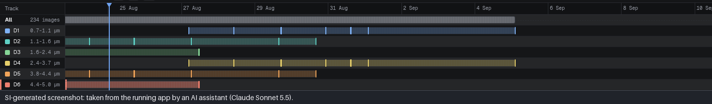

*Figure 12. The same timeline zoomed in around the playhead (blue line): four presses of the + button here. The ruler now shows days instead of months, and the first observing window (it ends on 27 August) is easier to read. A double-click on a window zooms to it in one step.*


- **Ruler:** shows months, then days, then hours as you zoom.
- **"All" row:** blocks for the observing windows, with the gap between them labelled in days.
- **Six lanes (D1 to D6):** one tick per real image of that detector. Clicking the lane of another prepared detector switches to it at the same time.
- **Click or drag** the track to scrub. **A plain click on the ruler** jumps the playhead there.
- **Zoom:** mouse wheel (around the pointer), the **+**, **−** and **Fit** buttons, or the keys `[` and `]`. **Shift+wheel** or dragging the ruler moves the view. **Double-click** a window to zoom to it; double-click empty space to fit everything. The smallest view is 6 hours.
- **A time with no observation** can be selected too. The picture turns blue-grey and says "No observation at this time", with the frames before and after (see the figure below). Next, previous and play still work from there.

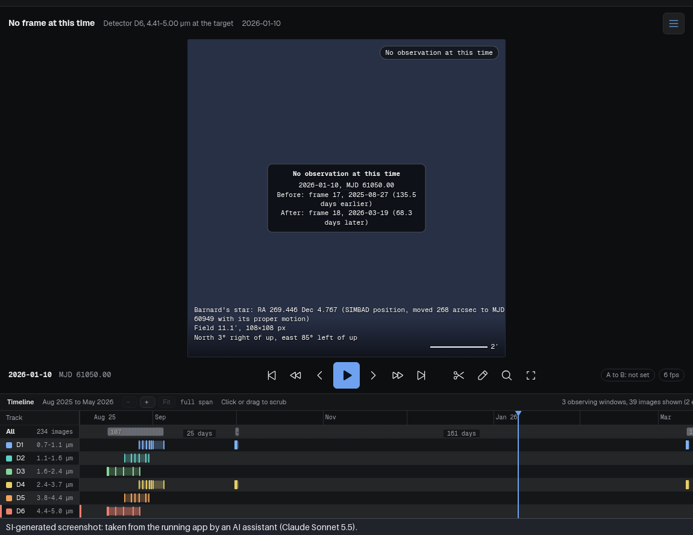

*Figure 13. A time inside a gap (10 January 2026, MJD 61050): no frame exists, and the page says how far the nearest frames are (135.5 days before, 68.3 days after).*


## 1.6 Keyboard and sharing a view

### Keyboard shortcuts

| Key | Action |
|---|---|
| Space | Play or pause |
| Left, Right | Back or forward one frame (Shift: 10 frames) |
| Home, End | First or last frame |
| Page Up, Page Down | Page Up: start of this observing window (again: the previous one). Page Down: the next window |
| I, O, X | Set clip point A, set B, clear |
| Z, P, F | Magnifier, marker, full screen |
| +, −, 0 | Zoom in, out, reset |
| `[`, `]` | Zoom the timeline out, in |
| Esc | Back one zoom step, then leave the tool |

### Share or bookmark a view

The page address holds the patch, the detector, the frame or time, and the ring (not the zoom, the stretch or the markers), so you can bookmark it or send it to someone who runs the same app:

| Part of the address | Meaning |
|---|---|
| `?target=KEY` | which prepared patch (the folder name, for example `ra269.4463_dec4.7675_s0.2_spherex_dr1`) |
| `d=D1` to `d=D6` | which detector |
| `f=N` | frame number (starts at 1) |
| `t=MJD` | the time, as a Modified Julian Date (opens the nearest frame, or an empty picture if no frame is close) |
| `ra=` and `dec=` (degrees) | put the Requested position ring on that spot (only when the spot is inside the patch) |

## 1.7 Reading what you see

### A good first look

Pick **Barnard's Star**. It is bright and moves about 1.7 pixels a year across the sky, so it is the easiest target to see. Press Space, or zoom into the picture and compare the first and last observing windows.

**Be careful with the faint targets.** WISE 0855 and Epsilon Indi B are very faint: in our check, nothing at their markers stood out from the noise in a single frame. Do not take a bright speck near the marker for them. A real mover such as WISE 0855 shifts only about **1 pixel over the whole year** (an estimate from an assumed motion), so you cannot see its motion by eye in the raw frames. This tool shows you what the data looks like. It does not prove that something moved.

### What the app does not do

- It does **not** detect, rank or name moving objects. You look; it shows.
- It has no contamination flags or known-object overlays yet (those boxes are shown but marked "not in demo").
- It is not a measurement tool. The "lossy cache" pixels in particular are for display only.
- It works for positions that NASA's SPHEREx release **DR1** covers. Release QR3 is not used.
- It runs on your own machine. There is no public website yet.

## 1.8 Troubleshooting

| Problem | What to do |
|---|---|
| I want another port, or no browser window | Put the option before the command: `PORT=8001 ./start.sh` or `NO_BROWSER=1 ./start.sh`. |
| `uv: command not found` | Install uv from <https://docs.astral.sh/uv/>, then run the start script again. |
| "Port 8000 is already in use" | Open `http://127.0.0.1:8000/` (it may be this app already). Otherwise start with `PORT=8001 ./start.sh`. |
| The front page says "The preparation service is not running yet" | Start it with `./start.sh`. The page waits and continues by itself. Prepared test targets open without it. |
| A new position takes very long | Normal: 5 to 10 minutes from Thailand. NASA's archive often answers "503 busy" and the service retries on its own. Wait, or press Cancel and try later. |
| "The queue is full" | Five positions are already waiting. Try again in a few minutes. |
| "DR1 has no images of this position" | SPHEREx release DR1 does not cover that spot. Try another position. |
| A detector is greyed out | It is not prepared and the service is not running. Start the service, then choose it again. |
| The picture is all blue-grey and says "No observation at this time" | The playhead is on a time when the telescope did not look. Click a tick on the timeline, or press Left or Right. (A normal frame can still have a blue-grey strip at its edge where the detector had no data.) |
| "This position is too close to the edge of the detectors to build a view" | The images only touch that spot at their edge. Try a position a little further in. |
| "The NASA archive did not answer" | NASA's archive was busy or slow. Wait a few minutes and try again. |
| Keys do nothing | The keyboard shortcuts are ignored while the cursor is in a text box or a menu. Click the picture first. |
| A detector is still greyed out after starting the service | Click the Detector menu (or the detector's name in the timeline) once. The page does not check by itself. |
| The page is blank or says "No data" | The prepared data for that patch is missing. Pick a test target on the front page, or prepare the position through the service. |
| Brightness looks wrong | Use the reset buttons in the sidebar (Display) or double-click the sliders. |
| I want to start over | Use a private browser window, or clear this site's stored settings. Prepared data in `implementation/data/cache/` is not touched. |

---

# Part 2. How it works

## 2.1 The big picture

### In plain words

NASA's SPHEREx telescope keeps taking pictures of the whole sky and puts them in a public archive. The pictures are big, and most of each one is of no interest to you. So the program asks the archive which pictures cover your spot, reads **only a small square around that spot** from each of them, lines the squares up so that stars sit in the same place, and squeezes them into small files. The web page then plays those squares like a short video. A small helper program on your computer does the fetching when you ask for a new place, and remembers it for next time.

### The flow in one picture

```
 NASA's SPHEREx archive (IRSA)                YOUR COMPUTER
 -----------------------------                -----------------------------
  search: "which images cover   ----------->   Python pipeline
   this position?"                              1 search
  public S3 bucket: the image                   2 read small regions
   files (we read only the                      3 line up on one sky grid
   small region we need)        ----------->    4 compress
                                                5 write display files
                                                        |
                                                        v
                                               cache folder (display files)
                                                        |
                       +--------------------------------+
                       v                                v
          local service (FastAPI)              web page (HTML, CSS, JavaScript)
          "is this position prepared?"  <--asks--  front page + viewer
          "no: prepare it" --- progress --->   progress bar, then the
                                               viewer opens on the new patch
```

Two programs cooperate:

1. **The pipeline** (Python) turns NASA's images into small files the browser can show.
2. **The page** (plain HTML, CSS and JavaScript, no framework, no build step) shows them. A small **local service** connects the two when you ask for a new position.

## 2.2 Where the images come from

**SPHEREx** is a NASA space telescope that maps the whole sky in 102 colours of near-infrared light (0.75 to 5.0 micrometres). It looks at any spot in the sky in **windows about six months apart**, and each time it takes a few dozen exposures. Six detector arrays (D1 to D6) each see a slice of the colours. In a single exposure, each detector's image has a slightly different wavelength depending on where on the detector the star lands, because the colour filter is a gradient. So **frames differ in wavelength as well as in time**.

NASA publishes the images at the **NASA/IPAC Infrared Science Archive (IRSA)** as calibrated "Level 2" FITS files. One file is about **65 MB**, and a single position can be covered by 115 to 451 of them. Downloading them whole would be far too slow, so the program takes only a **small region** of each:

- **Search:** the IRSA search service (SIA2) is asked "which images in the collection `spherex_dr1` cover this position?". The answer is a list (one row per image: file address, time, detector). It holds no brightness values.
- **Read just the region (default):** the files are also on NASA's public S3 bucket, which allows reading a byte range. FITS images are stored row by row, so the program reads the image header and only the rows around the position (about 2 MB, the image rows and their uncertainty, instead of 65 MB; roughly 4 to 8 seconds from Thailand). On a test frame the result was identical to NASA's own cutout.
- **Fallback:** if that route fails, the program asks IRSA's cutout service for a 0.2-degree region instead (about 4 MB, 10 to 17 seconds each). This route is slower and the archive often answers "503 busy", so the program retries politely.

The program is polite to the archive: a generic client name, no more than 3 requests at a time (a full fetch uses 2), retries with waiting, no looping over the archive, nothing personal sent anywhere.

## 2.3 The pipeline, step by step

The pipeline is `implementation/scripts/cell_cache_demo.py`. You normally never run it by hand, because the service does. Per position and detector it does this:

1. **Search** the archive for every image of the chosen detector that covers the position, sorted by time.
2. **Read a 0.2-degree region** of each image (about 117 pixels wide; one pixel is 6.15 arcseconds) with the real pixel values and their uncertainty.
3. **Put every frame on one sky grid.** Each image has its own pointing and distortion, described by a coordinate system (WCS). The program uses it to resample all frames onto the same grid, centred on the patch. A star that does not move now stays at the same pixel. Frames that cover less than 80% of the grid (the patch was near a detector edge) are dropped. The grid is mirrored left to right so the picture shows the usual sky view, with north near the top and east to the left.
4. **Compress with a lossy "cell store".** The grid is cut into 12 by 12 pixel cells. The first frame is stored in full. For each later frame, a cell is stored only if it changed by more than the measurement noise; otherwise the old value is reused. Changes are rounded to steps of half the noise. The result is about **10 to 15 times smaller** than raw numbers, with an average error of about 0.7 times the noise. It is a display format: it drops the flag layer and the PSF table, so never use it for measurements.
5. **Write the display files** for the page (`export --slim`): the real pixels (`sky.data.js`), the frame list for the timeline (`sky.index.js`), and the cell store (`sky.store.js`), and rewrites the list of patches (`targets.js`). `target.json` is written earlier, when the patch is first created.

**Moving targets.** Stars with large proper motion do not sit where a catalogue says. Barnard's Star is about 268 arcseconds (44 pixels) from its year-2000 position by 2026. For the named test targets, a developer command (`resolve`) asks **SIMBAD** (a public astronomy database; only the name is sent) for the position and proper motion and moves the position to the median time of the images, before anything is fetched. The five prepared test targets were built that way. A position you type on the web page is used exactly as typed, so for a fast-moving star give the position at the time of the observations. In our browser check, R Draconis and RW Aurigae sit within about 1 pixel of the marker, and Barnard's Star within about 2 pixels (it drifts between observing windows because it really moves about 1.7 pixels a year).

## 2.4 The cache: why a second visit is instant

Everything is kept in `implementation/data/cache/cell_demo/`, one folder per **patch** (a small piece of sky):

```
cell_demo/ra269.4463_dec4.7675_s0.2_spherex_dr1/     <- patch: rounded RA, Dec, size, collection
    target.json                                       <- name, position, how the position was found
    D6_full/                                          <- one folder per detector
        sky.data.js   sky.index.js   sky.store.js     <- display files the page loads
        raw/, store.cellcache, store.params.json      <- working files (not in git)
```

- **Naming:** the folder is named by position, size and collection, never by what you typed, so the same patch is found again from any spelling.
- **Reuse:** a request close to an existing patch (its centre within 30 arcseconds) reuses it. The service answers "ready" when a prepared patch covers the position (centre within 5 arcminutes) and the detector is exported.
- **Only what is missing:** a file already on disk is skipped when NASA's processing version is unchanged. A newly released or reprocessed image is fetched again. The `update` command does this for a whole patch.
- **Settings change:** the compressor's settings are recorded; if they change, the store is rebuilt.
- **What is in git:** only a small display set, about 21 MB, for the **five NASA test targets on detector D6**. So someone who only opens the repository sees real images at once. Everything else is in the cache folder and ignored by git. The data is untrusted input: it is read with astropy only.

## 2.5 The local service

`implementation/server/app.py` is a small FastAPI program. It does three things: it serves the pages, it answers "is this position prepared?", and it runs the pipeline as a background job when it is not. The page talks to it over a few plain web calls:

| Call | Meaning |
|---|---|
| `GET /api/health` | The service is up (and whether a job is running). |
| `GET /api/lookup?ra=&dec=&detector=` | `ready` (with the patch key), or the job already queued or running for that position, or `missing`. |
| `POST /api/prepare` | Queue a job for a position and detector. |
| `GET /api/jobs/{id}` | Progress of a job, for the progress bar. |
| `DELETE /api/jobs/{id}` | Cancel the job. |

Rules the service keeps: **one job at a time** and a queue of at most 5 (the archive is shared); a position already being prepared is not started twice; the collection (`spherex_dr1`) and the region size (0.2 degrees) are fixed; only validated numbers reach the pipeline, never anything else a person typed; a patch folder that ends up with no data (no images, or a cancelled job) is removed; prepared data is never cached by the browser, because the pipeline rewrites it; by default it listens on **this machine only**.

The page does not have to be served by the service. It can be opened as a file, and the service accepts it (a page opened as a file looks for the service on port 8000). If the service is not running when you ask for a new position, the page shows the start command and waits.

## 2.6 The web page

- **Front page (`implementation/web/index.html`):** the blank form. It checks your RA and Dec, asks the service, and either opens the viewer or shows the progress screen (`lib/prepare.js`). The coordinate rules are in `lib/coords.js`, shared with the viewer.
- **Viewer (`implementation/web/drafts/v1-studio-real.html` and `app.js`):** the "Studio" style the team chose. It loads one patch and one detector per page load as plain script files (`sky.data.js`, the timeline index of all detectors, and the cell store). Everything on screen comes from that data: nothing is simulated.
- **Browser decoder (`cellcache.js`):** decodes the lossy cell store in your browser when you choose "From the lossy cache". It was checked to give the same pixels as the Python decoder.
- **The timeline** is built from the data: the observing windows, the gaps in days and the ticks all come from the real exposure times, so nothing about them is typed in by hand.
- **No tracking, no network calls from the viewer** except to the local service. Your theme, display settings and whether the sidebar is open are remembered in your browser's local storage (nothing is sent anywhere); markers are not saved.

## 2.7 Files at a glance

| Path | What it is |
|---|---|
| `start.sh`, `start.bat` | Start the service and open the app. |
| `implementation/web/index.html`, `lib/` | Front page and its helper scripts. |
| `implementation/web/drafts/v1-studio-real.html`, `app.js`, `cellcache.js`, `real.css` | The viewer. |
| `implementation/server/app.py` | The local service. |
| `implementation/scripts/cell_cache_demo.py` | The pipeline (search, read, line up, compress, export). |
| `implementation/data/cache/` | The cache. Only the small display set of the five test targets is in git. |
| `implementation/tests/` | Manual checks (see below). |
| `research/challenge-12/` | Data findings, open questions, and the explainer page on how SPHEREx observes. |
| `docs/` | AI-use log, references and licenses, to-do list, handoff, this manual. |
| `submission/` | Drafts of the NASA submission form. |

## 2.8 For developers: commands and checks

Developer-level detail lives in [implementation/scripts/README.md](../implementation/scripts/README.md), [implementation/server/README.md](../implementation/server/README.md) and [AGENTS.md](../AGENTS.md).

The pipeline (normally run by the service):

```bash
PY="uv run --script implementation/scripts/cell_cache_demo.py"
$PY collections                                   # image collections the archive offers now
$PY resolve "Barnard's star"                      # SIMBAD lookup (name only)
$PY probe --target "Barnard's star"               # images per collection and detector
$PY fetch --target "Barnard's star" --detector D6 --full
$PY export --target "Barnard's star" --detector D6 --full --slim
$PY update --target "Barnard's star"              # only new or reprocessed images
```

Use `--ra DEG --dec DEG --name LABEL` instead of `--target` for any position.

The service reads these options from the environment: `PORT` (default 8000), `HOST` (default 127.0.0.1, this machine only) and `NO_BROWSER=1` (do not open a browser window), for example `PORT=8001 NO_BROWSER=1 ./start.sh`. A page that is not served by the service itself expects port 8000. Two more (`SKYFLIP_CACHE`, `SKYFLIP_PIPELINE_CMD`) exist for tests.

Notes on the commands above: `--target NAME` needs the saved lookups in `known_targets.json`, which is not in git, so on a fresh copy run `resolve` first (or use `--ra` and `--dec`). `update` re-exports without `--slim`, so the files it writes are about twice the size of the committed ones.

Checks (all manual, no test framework yet; the browser checks need Node 22 and Chrome or Chromium):

| Command | What it checks |
|---|---|
| `uv run --script implementation/tests/server_check.py` | The service and its job rules, with a stub pipeline (seconds). |
| `node implementation/tests/landing_check.js` | The front page, loading screen and detector menu in headless Chrome. |
| `node implementation/tests/web_real_page_check.js` | The viewer on the prepared data, with real mouse and keyboard events. |
| `node implementation/tests/cellcache_decode_check.js` | The browser decoder against the Python one. It compares pixels only for exports that are not slim, so on a fresh copy of the repository (all slim) it checks nothing. |
| `uv run --script implementation/tests/s3_vs_cutout_check.py` | (network) The two data routes give identical pixels. |
| `uvx ruff check implementation` | Lint. |
| `uv run --script implementation/scripts/build_manual.py` | Rebuilds `docs/user-manual.pdf` and `docs/how-it-works.pdf` from their Markdown files (needs Chrome or Chromium). |
| `node implementation/tests/manual_screenshots.js` | Retakes the screenshots in `docs/manual/img/` from the running app (start the service first; see the file header). |

## 2.9 What the program does and does not tell you

**It tells you:** what the real images look like, when each was taken (the real gaps), at what wavelength, and where a given sky position falls on them.

**It does not tell you:**

- That anything moved. Spotting motion is your job, and a candidate would need measuring and checking elsewhere.
- Anything about faint objects in a single frame. WISE 0855 and Epsilon Indi B are not visible in one image. The marker shows where the catalogue says they should be.
- Anything exact about brightness from the "lossy cache" option. It is for quick looks.
- Anything about positions NASA's release DR1 does not cover.

The data is NASA's public SPHEREx data via IRSA. Positions of named stars come from SIMBAD. The acknowledgements NASA and CDS ask for are on the page under **Credits** and in [references.md](references.md). The code and this manual were written with the help of an AI assistant; every use is logged in [si-log.md](si-log.md).

---

# Part 3. Glossary

| Term | Meaning |
|---|---|
| **SPHEREx** | NASA's space telescope that maps the whole sky in 102 infrared colours, from 0.75 to 5.0 micrometres. |
| **IRSA** | NASA/IPAC Infrared Science Archive, where SPHEREx images are published. |
| **RA, Dec** | Right ascension and declination: the sky's longitude and latitude. RA is in degrees (0 to 360) or hours, minutes and seconds. Dec is in degrees (-90 to +90). |
| **Patch** | A small piece of sky (the region fetched is 0.2 degrees; the grid shown is about 11 arcminutes) around a position. The unit the app prepares and stores. |
| **Detector (D1 to D6)** | One of SPHEREx's six cameras. Each sees a different range of infrared colours. |
| **Wavelength** | The colour of the infrared light, in micrometres (µm). It changes from frame to frame. |
| **Frame** | One image of the patch at one moment and one detector. |
| **Observing window** | A period when SPHEREx looked at the position. Windows are months apart, so the timeline has real gaps. |
| **MJD** | Modified Julian Date: a day count used for observation times. |
| **Pixel** | One image square. Here it covers 6.15 arcseconds of sky. |
| **MJy/sr** | Megajanskys per steradian: the brightness unit of the images. |
| **Sigma (σ)** | The noise level of an image. The black and white points are set in units of it. |
| **Stretch** | How brightness is turned into grey (linear, asinh or log). |
| **Proper motion** | A star's slow movement across the sky. Barnard's Star moves about 10 arcseconds a year. |
| **WCS** | World Coordinate System: the numbers that say which sky position each pixel of a file shows. |
| **Lossy cell store** | The compact format used to keep many frames: it stores only the cells (12 by 12 pixels) that changed beyond the noise. |
| **Cutout** | A small region cut out of a large NASA image. |
| **CORS** | A browser rule. NASA's search service does not allow web pages to call it directly, which is why the local service exists. |
| **SIMBAD** | A public astronomy database, used to look up the positions and proper motions of named stars. |
